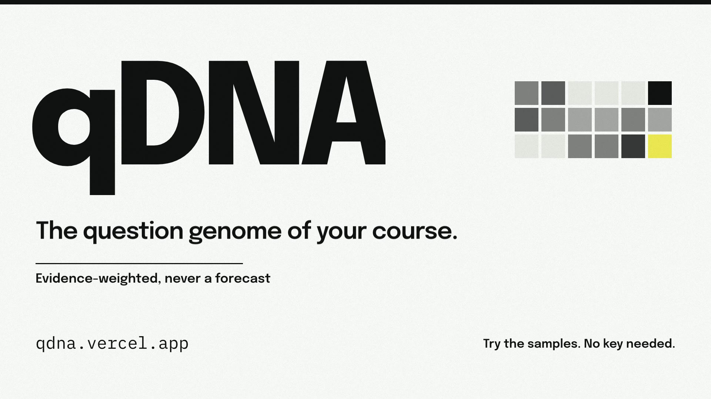
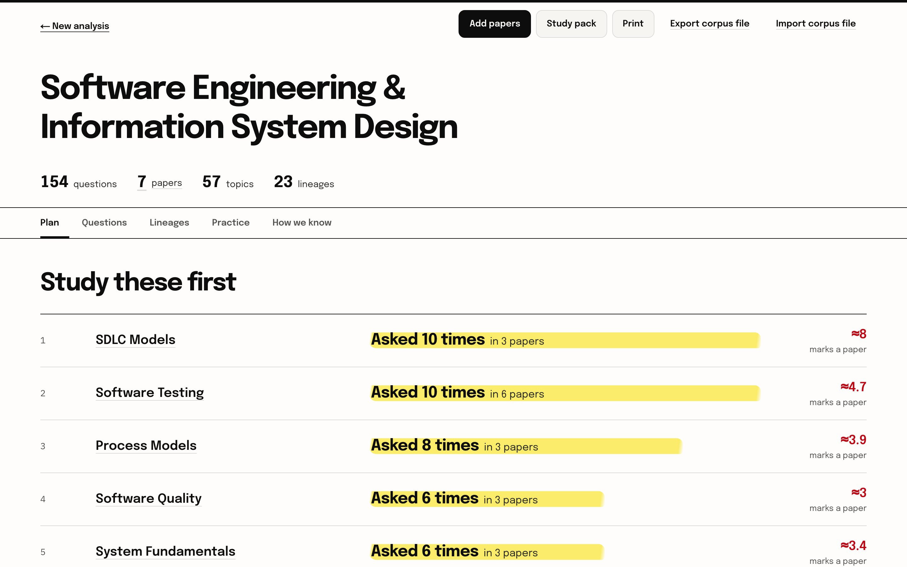
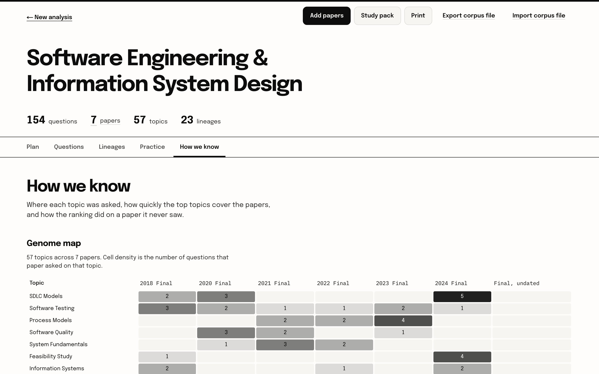
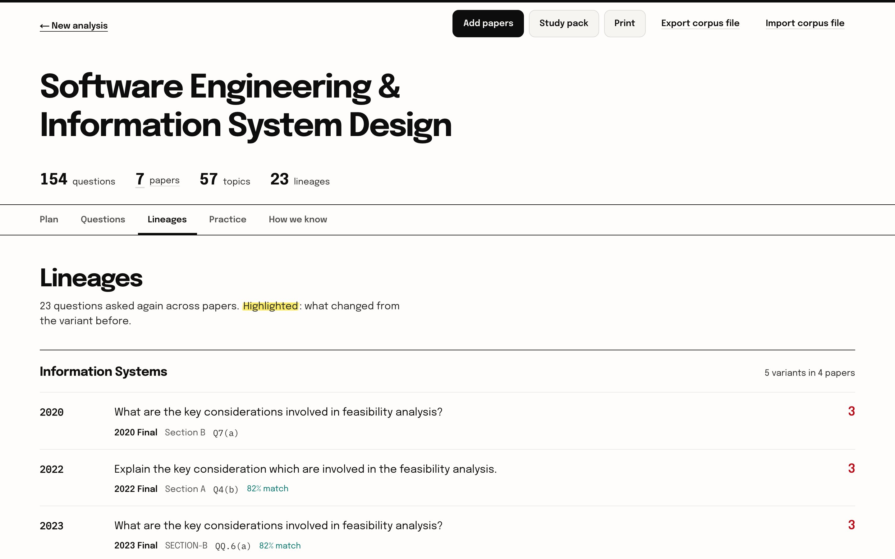
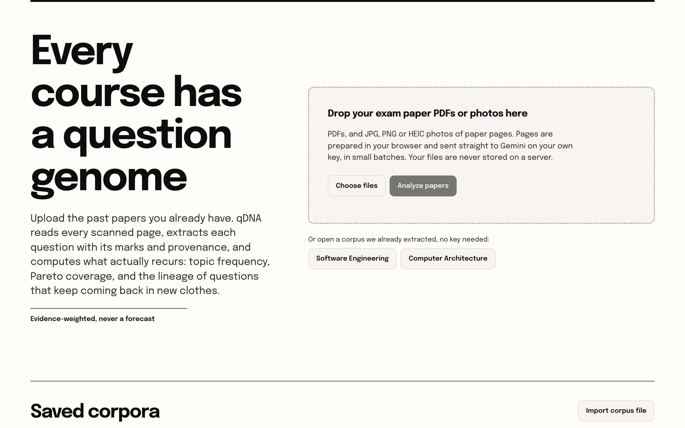
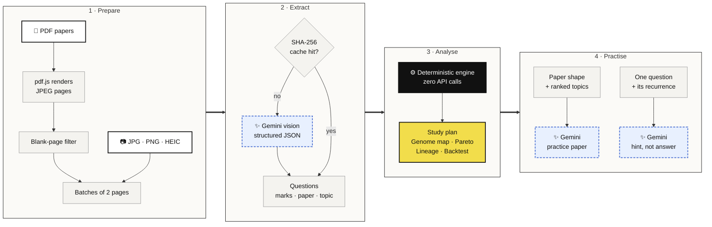

<!-- PROJECT LOGO -->
<p align="center">
  <a href="https://qdna.vercel.app">
    
  </a>

  <h3 align="center">qDNA</h3>

  <p align="center">
    The question genome of your course. Evidence-weighted, never a forecast.
    <br />
    <a href="https://qdna.vercel.app"><strong>Try it live »</strong></a>
    <br />
    <br />
    <a href="docs/launch-video/qdna-launch.mp4">Launch film</a>
    &middot;
    <a href="https://github.com/adib-11/qdna/issues">Issues</a>
    &middot;
    <a href="docs/adr">Architecture decisions</a>
    &middot;
    <a href="CONTEXT.md">Domain glossary</a>
  </p>
</p>

<p align="center">
  <a href="https://github.com/adib-11/qdna/actions/workflows/ci.yml"></a>
  <a href="https://qdna.vercel.app"></a>
  
  
  
  
</p>

<!-- ABOUT THE PROJECT -->

## About qDNA

https://github.com/user-attachments/assets/18342adf-197f-4f00-b134-076d0b630094

<p align="center"><sub>Launch film, 80 s, with sound · <a href="docs/launch-video/qdna-launch.mp4">full-quality 1080p file</a> · <a href="docs/launch-video/storyboard.html">storyboard source</a> (open locally in a browser)</sub></p>

**qDNA** turns the scanned past papers a student already has into a ranked,
auditable answer to *"what do I study first?"*

It extracts every question into structured JSON with Gemini vision, then
computes a deterministic *question genome* for the course: topic frequency,
Pareto coverage, question lineage (near-duplicate clustering across papers and
departments), and expected-marks ranking.

It is a prioritization tool, never a forecast. Every number it shows is
counted from the papers you supplied, and every topic links back to the source
questions that produced it. The statistics are ours; Gemini is the sensor.

### Why qDNA?

- **Your key, your files.** Every model call goes from your browser straight to
  Gemini on your own key. No file is uploaded to or stored on qDNA's server.
- **Counted, not guessed.** Rankings are counts over a corpus that vision made
  countable, not a model's opinion about what matters.
- **Auditable end to end.** Every topic expands to the exact questions behind
  its count, with paper, section and marks.
- **Tested against the future.** A built-in backtest hides a paper, ranks from
  the rest, then shows how the ranking did on the paper it never saw.

## Features

<table>
  <tr>
    <td width="50%"></td>
    <td width="50%"></td>
  </tr>
  <tr>
    <td><b>Study plan.</b> Topics ranked by how often they were asked and the marks they carry a paper.</td>
    <td><b>Genome map.</b> Topics down, papers across, cell density by question count.</td>
  </tr>
  <tr>
    <td width="50%"></td>
    <td width="50%"></td>
  </tr>
  <tr>
    <td><b>Lineages.</b> Each recurring question with all its variants, its source paper, a similarity score, and what changed highlighted.</td>
    <td><b>Upload.</b> PDFs or JPG, PNG and HEIC photos, prepared in the browser. Two sample corpora open with no key.</td>
  </tr>
</table>

- **Headline stat.** One computed sentence, e.g. *"7 topics out of 17 cover
  74.5% of every question asked."*
- **Pareto curve.** Topic bars with cumulative coverage and the 70% threshold.
- **Topic dossier.** Every topic expands to the questions behind its count. Any
  question opens a **hint**: the approach and the governing principle, never
  the final answer.
- **Backtest.** Hide a paper, rebuild the ranking from the rest, then reveal
  it. On the bundled Software Engineering corpus, holding out the 2024 final:
  the 21 topics ranked from the six earlier papers covered **37.5%** of it, and
  **11 of its 24** questions were variants of a question asked before.
- **Practice paper.** A paper written in the corpus's own shape. Sections,
  question counts and mark denominations are measured from the uploads and
  sent to the model as a constraint, so the structure is arithmetic and only
  the wording is generated.
- **Corpus files and study packs.** Save, export, import and print a corpus.
  Add or remove papers later without starting over.

Fewer than three papers and the view says so up front: the counts are still
shown, described as a count over that corpus rather than as recurrence.

### Built With

- [Next.js](https://nextjs.org/) 16 (App Router), [React](https://react.dev/) 19, TypeScript
- [Tailwind CSS](https://tailwindcss.com/) v4
- [`pdfjs-dist`](https://github.com/mozilla/pdf.js) for client-side page rasterisation
- [`@google/genai`](https://github.com/googleapis/js-genai) for structured vision extraction, called from the browser
- [Recharts](https://recharts.org/) for the Pareto view
- [Vitest](https://vitest.dev/), [Playwright](https://playwright.dev/) and [axe-core](https://github.com/dequelabs/axe-core) for tests
- Deployed on [Vercel](https://vercel.com/)

<!-- ARCHITECTURE -->

## How it works



Dashed blue nodes are the only model calls. Each goes from the student's
browser straight to Gemini on the student's own key. Everything else,
including all of the analysis, runs locally with no API call.

### Privacy and keys

Every model call goes from the student's browser straight to Gemini on the
student's **own key** ([ADR 0001](docs/adr/0001-own-key-only.md)). The key is
asked for only when an action needs a model, checked with a models-list call,
held in memory unless the student chooses to remember it, and sent only to
Google. The bundled samples and all analysis need no key.

qDNA's server routes (`/api/extract`, `/api/tutor`, `/api/practice-paper`) are
kept for a possible paid tier but hold no key and answer 503.

Pages are prepared **in the browser**. Extraction results are cached by
page-image content hash, so re-analysis costs no API quota. A failed batch
never discards the batches that succeeded, and a cancelled extraction keeps
the pages that finished.

### Working within the free tier

Measured, not assumed. The free tier meters requests per day **per model**, at
20/day for `gemini-flash-latest`: not enough for one 35-page paper on its own.
Three things follow, and all three are in the code:

- **2 pages per request.** Fewer would run out of daily quota before the paper
  ends; more stops returning inside the function window, because verbatim
  transcription of a dense page is 25–47 s of output.
- **A chain of flash models.** A `429` moves to the next model, which has its
  own daily budget, so quota is pooled rather than capped at 20.
- **A content cache.** Results are cached by page-image SHA-256, so the same
  pages are never paid for twice.

### Sample corpora

Two corpora ship in [`data/`](data), extracted with the same pipeline from
real RUET papers, so the tool can be tried without an upload, an API key, or a
network call. They were produced by
[`scripts/extract-corpus.mjs`](scripts/extract-corpus.mjs), which rasterises
with `pdftoppm` and then uses the same prompt, schema, batch size, and model
chain as the browser path.

<!-- GETTING STARTED -->

## Getting Started

### Prerequisites

- Node.js 20.9 or later (CI uses Node 24)
- npm
- A Gemini API key, only to extract new papers. The samples and all analysis
  run without one.

### Setup

1. Clone the repo

   ```sh
   git clone https://github.com/adib-11/qdna.git
   cd qdna
   ```

2. Install packages

   ```sh
   npm install
   ```

3. Start the dev server

   ```sh
   npm run dev
   ```

4. Open http://localhost:3000 and pick a sample corpus, or drop in your own
   papers and paste your Gemini key when asked.

The app needs no server-side key. `GEMINI_API_KEY` in `.env.local` (see
[`.env.example`](.env.example)) is read only by the offline
`scripts/extract-corpus.mjs` and is never committed.

### Testing

```sh
npm run lint
npm run typecheck
npm test                       # Vitest: analysis, extraction, corpus files
npm run build                  # Playwright runs against the production build
npm run test:e2e:install       # once: Playwright's Chromium
npm run test:e2e               # Playwright + axe, Gemini stubbed at the network level
```

[CI](.github/workflows/ci.yml) runs lint, Vitest, the build, typechecking and
the Playwright suite on every push and pull request. The suite runs axe on
every app state and allows zero WCAG 2.2 AA violations. Gemini is stubbed at
the network level, so CI needs no secret and never calls a model.

## Project structure

```
app/            Next.js routes: / (upload), /analyze (results), /api/* (503 stubs)
components/     UI: study plan, genome map, lineage cards, practice paper, tutor
lib/analysis/   Deterministic engine: frequency, Pareto, lineage, backtest, expected marks
lib/extract/    Extraction run: uploads, sessions, batch orchestration
lib/pdf/        Client-side rasterisation, blank-page filter, batching
lib/gemini/     Prompts, schema, extraction, hints, practice paper, topic grouping
lib/cache/      Page-image SHA-256 result cache
lib/corpus/     Corpus store, corpus files, add/remove papers, study packs
data/           Bundled sample corpora (Software Engineering, Computer Architecture)
docs/adr/       Architecture decision records
docs/launch-video/  Launch film, storyboard, audio and render pipeline
e2e/            Playwright + axe specs
tests/          Vitest specs
```

## Contributing

1. Read [`CONTEXT.md`](CONTEXT.md) for the domain language (course, offering,
   corpus, paper, lineage) and the [ADRs](docs/adr) for decisions already made.
2. Open an [issue](https://github.com/adib-11/qdna/issues) describing the change.
3. Branch from `main`, keep lint, unit tests and the Playwright suite green,
   and open a pull request.

## Acknowledgements

- Built for Hackdays @ RUET 2026, where it won.
- Sample papers are past exam papers from RUET (Rajshahi University of
  Engineering & Technology).
- Launch film voice by [Fish Audio](https://fish.audio); score and sound design
  synthesised in [`build_audio.py`](docs/launch-video/audio/build_audio.py).
